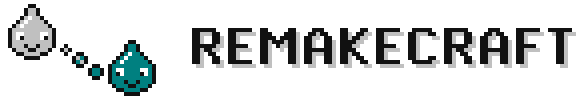
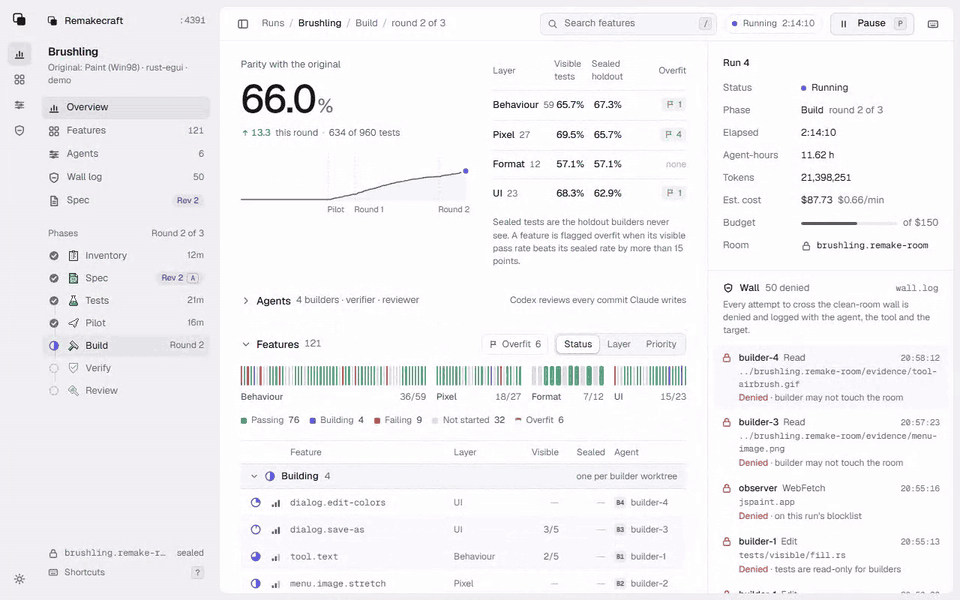
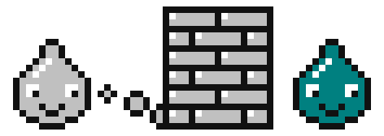

<!-- Launch gate: grep for two opening braces must find nothing. Never fill a number that was not measured. Only Brushling and legal placeholders remain; they wait on the full Brushling run. -->

<h1 align="center">
  <picture>
    <source media="(prefers-color-scheme: dark)" srcset="assets/mascot/header-dark.svg">
    
  </picture>
</h1>

<p align="center"><b>Every app is open source now. Its behaviour, not its code.</b><br>
A Claude Code plugin that writes a spec and tests from what an app does, then has separate agents rewrite it from scratch behind a logged wall.</p>

Name an app you may lawfully use. Remakecraft inventories it from black-box evidence, writes a behaviour spec you approve, and writes conformance tests **before any code**. About 30% of the tests are **sealed**: the builders' tools are denied them and only the harness runs them. Up to 5 builders then write a native rewrite in parallel worktrees (the toy run used one), Codex reviews it when installed (Claude otherwise), and you get a **parity** score: the share of all tests, sealed included, that the rewrite passes.

```
/plugin marketplace add remakecraft/remakecraft
/plugin install remakecraft@remakecraft
/remakecraft:try
```

Needs **Claude Code 2.1.295+** (older versions ignore fail-closed hooks, so the wall would fail open) and **Node 20+**. Restart Claude Code after installing. `/remakecraft:try` rebuilds a bundled 50-line toy app on Sonnet; add `--full` for the settings of the measured run.

For your own apps, abandoned software, interoperability and learning. Read [Responsible use](#responsible-use) before you point it at someone else's app.

**Proof so far: two measured runs.** Brushling, a Windows 98-era Paint rewrite in Rust, passes **470 of 471** conformance tests (99.7%), **154 of 154 sealed**, in about 3 hours for $41 in tokens. On the bundled toy app, the rewrite passes **187 of 191** conformance tests (97.9%), **72 of 74 sealed**, in 35 minutes for $6.29 in tokens. All four failures are Windows-only skips, which count as fails. The run before it failed: it leaked five internals of the toy into the spec, which is how the wall got fixed ([scoreboard](#scoreboard)).

<p align="center">
  <picture>
    <source media="(prefers-color-scheme: dark)" srcset="assets/readme/run-page-dark.gif">
    
  </picture>
  <br><sub>The live run page, shown in its simulated demo mode.</sub>
</p>


<p align="center">
  <a href="https://github.com/remakecraft/remakecraft/actions/workflows/ci.yml"></a>
  <a href="LICENSE"></a>
  <a href=".claude-plugin/plugin.json"></a>
  
</p>

**The wall.** Everything taken from the original (your screenshots, recordings, the inventory, the sealed tests) lives in a separate folder, *the room*. A hook denies and logs any builder, verifier, reviewer or merger call that names the room or walks up out of the app tree. It is **a logged tripwire, not a sandbox**: a path built at run time is not caught, and the model's training data is outside it. [Limits](#limits) has the full list.

```
/remakecraft:remake <app> [--stack rust-egui|tauri|web] [--builders 1-5] [--cheap] [--bin <entry>] [--out <dir>] [--with-rea | --open --basis own|license|authorized]
```

---

## How it works

| | Phase | Agent | Sees | Writes |
|---|---|---|---|---|
|  | 1 Inventory | observer (Opus) | your screenshots, recordings, the app's public docs | every menu, tool, shortcut, dialog and file format, each with an id |
|  | 2 Spec | spec-writer (Opus) | the inventory and evidence | `spec.json`: behaviour only, no expression. **You approve it here** |
|  | 3 Tests | test-writer (Opus) | the spec only, never the evidence | conformance tests: ~70% visible, ~30% sealed |
|  | 4 Pilot | builders | spec + visible tests | 10 features, then a cost extrapolation you approve |
|  | 5 Build | 1–5 builders (Sonnet), one worktree each | spec + visible tests | the app |
|  | 6 Verify | verifier + harness | visible results, sealed **counts** | hash check, stub scan, parity report |
|  | 7 Review | reviewer via Codex CLI (Claude when Codex is absent or cannot sandbox reads to the app tree, as on Windows) | the diff and the spec | ranked findings that go back to step 5 |

Every run serves a live page on localhost: parity per layer with sealed results as counts, each feature, the agents, and the wall log as it happens. Pause it or approve the spec from there.

Runs resume from progress files and git checkpoints after a crash or a usage-limit stop. Models are configurable per run; `--cheap` runs everything on Sonnet with one builder.

Cloning a CLI on the `web` or `tauri` stack? Pass `--bin <entry>` (for example `--bin bin/<app>.mjs`): every test then runs against that entry point.

Phases 5 to 7 run as the `/remakecraft:build` workflow when Claude Code can show it for review. Headless (`claude -p`) there is no one to review it, so the session drives the same loop itself: builders, merger, verifier and reviewer as subagents, one stage after another, with the same roles under the wall and the same logs. `scripts/build-steps.mjs` prints that loop for the run.

## How the wall works

<p align="center"></p>

A run has two trees. The **app tree** (`<app>/`) holds the spec, the visible tests and the code. The **room** (`<app>.remake-room/`) holds everything that came from the original: evidence, inventory drafts and the sealed tests. Builders work in worktrees of the app tree, so the room is never under their feet, and a `PreToolUse` hook denies their calls that name it.

| Rule | Who it binds |
|---|---|
| No decompilers or disassemblers (Ghidra, IDA, radare2, dnSpy, ILSpy, `objdump -d` and ~15 more) are denied by name | everyone, the main session included |
| Calls that name an entry on the run's blocklist (known open-source reimplementations of the target) are denied | everyone |
| Room roles' Write and Edit calls stay inside the room; shell writes are not checked | room side |
| The test-writer is denied calls that name `<room>/evidence` | test-writer |
| Builders, merger, verifier and reviewer are denied any tool call that names the room, including symlinks passed to Read, Write, Edit, Grep or Glob, and calls that name `wall.log` or `audit.log` | clean side |
| Clean-side shell commands that name a path resolving above the tree (`grep -r . ..`, `cp -r .. x`, `ln -s .. up`, `cd ../..`), into the room, or into the run logs are denied; paths built at run time (`$(dirname $PWD)`, a script) are not resolved | clean side |
| Clean-side shell calls that start a known agent CLI by name (`claude`, `codex`, `gemini` and the like) are denied, except the reviewer's Codex call, which runs under a read-only-app-tree profile (`reviewer.md`); the hook checks that the flag is present | clean side |
| Builders' and the merger's Write and Edit calls can't touch `tests/`, `spec/` or `remake.json`; a shell edit fails the hash check at the next verify. Hashes are checked by the verifier after each build round, and again after the build and the test run | builders, merger |

The hook is **a logged tripwire against accidental crossing, not a sandbox** (see [Limits](#limits)). It **fails closed** inside a run once it has found the run: if it errors, crashes or `remake.json` is unreadable, the call is blocked. Every denial is appended to `.remake/wall.log` with the paths it named and a sha256 of its input, never the content. Every agent that starts, and every prompt the session sends one, is recorded in `.remake/audit.log`. Here is a builder trying the room twice in the live wall test on 2026-10-13 (paths shortened, current log format):

```jsonl
{"at":"2026-10-13T17:14:38.618Z","role":"builder","agent":"remakecraft:builder","tool":"Read","targets":["…\\wall-live\\brushling.remake-room\\evidence\\secret.txt"],"sha256":"69e789b0e3be30342901bd57a51e3f17470b1f34f52e9d68b1c25a00c95da3d4","reason":"Clean-room wall: builder may not touch the room. Work from spec/ and tests/ in the app tree."}
{"at":"2026-10-13T17:14:39.074Z","role":"builder","agent":"remakecraft:builder","tool":"Bash","targets":["../brushling.remake-room/evidence/secret.txt"],"sha256":"f35375ae5195b0aa7094926a4d3e77549d65b936982dd9f3140b53c673ecd6ae","reason":"Clean-room wall: builder may not touch the room. Work from spec/ and tests/ in the app tree."}
```

The full Brushling run logged **11 denials across 42 agents**: builders and reviewers reaching for review notes, session transcripts or the evidence.

The rules are in [`hooks/wall.mjs`](hooks/wall.mjs), pure logic with [unit tests](tests/wall.test.mjs). Read them; the wall is only worth what you can check.

## Modes

| Mode | Who may look inside the original | Labelled |
|---|---|---|
| **Clean (default)** | nobody | clean-room |
| `--with-rea` | the observer alone, through REA, decompilers and `<room>/original/`. It writes behaviour only, and publish refuses a spec or visible test that still carries code (addresses, disassembly, decompiled conditions, names from the binary) | clean-room, observer uses REA |
| `--open` | every role | **open mode: not clean-room**, in every report |

Sealed tests stay sealed and hashed in every mode, and the blocklist still holds. `--with-rea` and `--open` need `--basis own|license|authorized`: you own the app, its license allows it, or you are authorized. Decompiling may breach the app's EULA; whether you may is your call, and Remakecraft records the basis you gave. MCP tools go through the wall too: the clean side gets none but the ones `mcpAllow` in `remake.json` names.

## Works with REA

[REA](https://github.com/morluto/rea) explains how an app works. Remakecraft rebuilds the whole app, and in clean mode keeps the builders clean. They fit together: start a run `--with-rea` and the observer uses REA's MCP server (`npx rea-agents setup` registers it as `rea`) to settle what watching the app leaves open, while the builders' calls into the room are still denied and logged. Set `REA_MCP_INPUT_SCHEMA_PROFILE=compact` in that registration: REA's full tool schemas are bigger than a subagent's context. To watch it end to end on the bundled MIT toy, run `/remakecraft:try --with-rea`.

## Scoreboard

One number per clone, then the layers. Sealed tests count. Nothing is rounded up.

| Clone | Behaves like | Stack | **Parity** | UI | Behaviour | File formats | Sealed pass | Tests | Wall time | Cost | |
|---|---|---|---|---|---|---|---|---|---|---|---|
| [Brushling](https://github.com/remakecraft/brushling) | Windows 98-era Paint | Rust + egui | **99.7%** | 100% | 99.6% | 100% | 154/154 | 471 | 2 h 56 min | $41.08 | |
| Sweepling | XP-era Minesweeper | Rust + egui | **100%** | 100% | 100% | 100% | 78/78 | 265 | 2 h 40 min | $30.50 | |
| tally (toy, bundled in [`evals/fixtures`](evals/fixtures/toy-original)) | a 50-line command-line counter | Node | **97.9%** | n/a | 97.8% | 100% | 72/74 | 191 | 35 min | $6.29 | `/remakecraft:try` |
| tally, `--with-rea` | the same counter, observer using REA | Node | **100%** | 100% | 100% | 100% | 33/33 | 108 | 29 min | $6.58 | `/remakecraft:try --with-rea` |

Brushling's one failure, `tool.polygon`'s `click_first_vertex_closes`, is a spec defect the review caught: the test expects a pixel that is not on the triangle. Its cost includes orchestrator overhead, and its wall time includes moving the run between machines halfway. Tally was run once on Windows: 4 tests skip there (no read-only folder), and a skip counts as a fail. Its cost is a floor, since workflow agents may be missing from the usage totals, and a replay against the original found one difference (`help` prints a shorter usage line) that no test caught. Run 1 of the same app cost $3.70 and failed for the reasons above. The `--with-rea` run's observer made 4 REA calls, which settled 7 of its 27 inventory items; no clean role called REA. None of its 14 wall denials was an attempt on the room: they were search patterns read as paths, temp files and reports aimed at the shared scratchpad or the run logs, and one verifier prompt that named the room. All of them came before that night's wall fixes, which give clean roles `.remake/tmp/`. Its wall time leaves out 107 minutes it sat at the spec checkpoint, headless, waiting for the approval. It has fewer tests than the clean run because it has a smaller spec (17 features against 27), so the two scores are not a like-for-like comparison.

Sweepling ran overnight, headless, from a 34-feature spec; its 33 pixel tests (also 100%) are a fourth layer with no column here. Its wall time leaves out 106 minutes at the spec checkpoint, and its cost is the run's own estimate. The suites drive the app headless, so dialog placement, focus and sound were never checked in a real window. The last review ran on Claude, because Codex cannot sandbox reads on Windows; its one must-fix (the Custom dialog's button column) was fixed after it and passes the tests, but was not re-reviewed. Its 10 wall denials were all the same kind as the toy's: logs, the shared scratchpad and paths above the app tree, none naming the evidence.

Parity is the pass rate of the conformance suite (visible + sealed), by layer; read it as spec conformance. It measures what the spec says the original does, so a missing spec line is a gap the score cannot see. The spec is published next to each clone so you can check it.

## Other agents

The pipeline is agent-neutral. **The wall is a Claude Code feature**: everywhere else the same rules ship as instructions in [`AGENTS.md`](AGENTS.md), and nothing enforces them.

| Agent | Install | Wall |
|---|---|---|
| **Claude Code (Recommended)** | `/plugin marketplace add remakecraft/remakecraft` then `/plugin install remakecraft@remakecraft` | enforced by hooks, logged |
| Codex | `codex plugin marketplace add remakecraft/remakecraft` then `codex plugin add remakecraft@remakecraft` | instructions only |
| Cursor, Gemini CLI, Copilot, OpenCode and other Agent Skills hosts | `npx skills add remakecraft/remakecraft` | instructions only |

## Compared with

| | Remakecraft | [replica-skill](https://github.com/Jakeschincariol/replica-skill) | [ArtCraft](https://github.com/storytold) | [JS Paint](https://github.com/1j01/jspaint) |
|---|---|---|---|---|
| What it is | a pipeline you run on a desktop or web app you may lawfully use | a pipeline for web/SaaS apps | a suite of AI-built app rewrites | a hand-built Paint remake |
| Spec and build in separate contexts | yes (separate subagents; room calls hook-denied) | no, one session | no, one operator | n/a |
| Tests before code | yes | Playwright, after the build | tests plus a real-app oracle corpus | n/a |
| Tests denied to the builder's tools | ~30% sealed, run by the harness | no | not documented | n/a |
| Review | Codex when installed, Claude otherwise | not documented | not documented | n/a |
| Score | one number + layers, sealed included | weighted checklist + screenshot diff | breadth % + "ready" % | n/a |
| Output | native or web, your pick | web | native Rust | web |

Facts as of 2026-10-13, from each project's public repo. Corrections welcome as issues.

## FAQ

**How is this different from REA?** [REA](https://github.com/morluto/rea) shows you how an app works inside: it decompiles and inspects it, then helps you rebuild a feature. Remakecraft rebuilds it without looking inside: black-box evidence only, tests before code, a hook-enforced wall and a score that includes sealed tests the builders' tools are denied. They answer different questions, and the two compose: see [Works with REA](#works-with-rea).

**What does a run cost?** The toy app's full run cost $6.29 in tokens (Opus and Sonnet) and 35 minutes. `--cheap` runs the agents on Sonnet with one builder, but the session you start it from keeps your model: on the one measured cheap run ($7.15) that session was half the bill, so run `/model sonnet` first. `--budget <usd>` stops the run at the next checkpoint once it is spent. Real apps cost more, and the pilot phase extrapolates before you approve the build.

**Is the output legally clear of the original?** Not guaranteed. See [Responsible use](#responsible-use), [Limits](#limits) and [Not affiliated](#not-affiliated).

## Responsible use

Remakecraft is for rewriting **your own apps, abandoned software you have the right to use, interoperability and learning**. It does not give you a licence to the original, and it is not a way to get paid software for free.

- **Not for** DRM, copy protection, licence checks, anti-cheat or security software, and never for bypassing a protection to run or inspect an app.
- **You are responsible** for the original's licence agreement, and for the clone's name, icon and look (trademarks and trade dress), patents, and anything you publish.
- **Clean mode is the default.** Modes that let agents look inside the original need a recorded basis (you own it, its licence allows it, or you are authorized), and the open mode is not a clean room.
- **No warranty.** MIT, as is. A clean-room process is evidence, not a legal guarantee.

What each mode means legally, and how rights holders reach the author: [LEGAL.md](LEGAL.md).

## Limits

- **Early alpha.** Three measured end-to-end targets so far: Brushling, Sweepling and the toy app above. Expect rough edges and file them.
- **The wall only holds in Claude Code.** On other agents it is the honour system.
- **The wall is a tripwire, not a sandbox.** The hook matches tool arguments and shell text. A command that reaches the room without naming it is neither denied nor logged. MCP calls go through the same wall, which denies and logs calls that name the room. Claude Code's OS sandbox would close that gap, but a plugin can't enable it, it covers the whole session rather than one role (the observer has to run the original), and it doesn't run on native Windows, so Remakecraft does not turn it on.
- **The orchestrating session is not clean.** It spawns both sides and reads what they return. Keep the evidence out of your own prompts to the clean side; the hook blocks room paths and blocked names in them, not paraphrase.
- **The model has read the internet.** For a closed-source target the original's code was never public, but open-source remakes of popular apps almost certainly are in the training data. The blocklist keeps them out of every agent's tools; it can't remove them from the weights. A similarity and licence scan of Brushling against known Paint remakes is still pending.
- **Parity measures the spec, not the original.** A behaviour nobody wrote down is not tested.
- **Desktop and web apps only** in v1. Not for DRM, anti-cheat or security software.
- Brushling's background removal copies a feature the original only gained in 2023. It is flagged as newer than the rest of the target; no patent review has been done.

## Not affiliated

**Not affiliated.** Remakecraft and Brushling are independent open-source projects. They are not affiliated with, sponsored by or endorsed by Microsoft Corporation or any other maker of software Remakecraft is pointed at. Microsoft, Windows and Microsoft Paint are trademarks of the Microsoft group of companies. They are mentioned only to describe what Brushling behaves like.

**Brushling specifically** contains no Microsoft code, icons, fonts, images or help text. It has its own name and icons, and copies layout and behaviour only. No human edited its code. The Remakecraft run produced the app and its test harness; the window and browser shell around it was added afterwards by Claude outside the wall, from the app's own public API, and does not change the parity score.

**Clean room, legally.** Clean mode is the default; the [modes](#modes) that lower it say so. The process and its limits are in [How the wall works](#how-the-wall-works) and [Limits](#limits). A documented clean-room process is evidence of independent creation, not a legal guarantee; whether a wall between agent contexts counts like a wall between human teams has not been tested in court. Pick your own name, icons and colours for every clone. This README is not legal advice.

## Community clones

Ran Remakecraft on something? Open a pull request adding a row, with a link to the clone, its `parity.json` and its `wall.log`, so anyone can check the score and the wall.

| Clone | Behaves like | Parity | By |
|---|---|---|---|
| _yours here_ | | | |

Want an app cloned next? [Request it](https://github.com/remakecraft/remakecraft/issues/new?template=clone-request.yml). The first three are picked by hand; after that, requests with the most votes go next.

## Contributing

Pull requests welcome, especially new blocklists, stacks and wall rules. Run `npm test` and `npm run validate` first.

- Questions and ideas: [GitHub Discussions](https://github.com/remakecraft/remakecraft/discussions)
- Docs: https://remakecraft.hellosverre.com

## Credits

[ArtCraft](https://github.com/storytold) by Brandon Thomas showed that agents can rewrite a big desktop app from behaviour alone. Remakecraft packages that idea as a pipeline anyone can run, with the wall made checkable. Ideas also borrowed from [greenfield](https://github.com/prime-radiant-inc/greenfield) (sanitised specs), [rebuild-dossier](https://github.com/Parker-Fawcett/rebuild-dossier) (held-out tests must never print their answers) and [clean-room-plugin](https://github.com/T-Rzeznik/clean-room-plugin) (a wall made of tool permissions).

## License

[MIT](LICENSE). Clones carry no licence until you add one.
