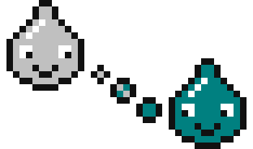

# Blot & Blit

Remakecraft's mascots are two pixel-art paint drops. **Blot** is the original, in Windows 98 silver. **Blit** is the remake, in Windows 98 desktop teal. The names come from BitBlt: Blot is the inkblot, and Blit is its pixel copy. Blit is drawn from the same grids as Blot, with only the body colour changed.



## Files

| Use | File |
|---|---|
| README header (wordmark + drip) | `header-light.svg`, `header-dark.svg` (shown at 4x), `header-light-8x.png`, `header-dark-8x.png` (2x retina) |
| Main mascot ("the drip") | `drip.svg`, `drip-4x.png`, `drip-8x.png`, `drip-16x.png` |
| Main mascot, animated | `drip-anim.svg` |
| Alternate poses | `eye-contact.svg` (bobs), `blink.svg`, `blink-anim.svg`, `brush.svg` |
| Clean-room wall | `wall.svg`, `wall-4x.png` |
| Run phase icons, 14x14 | `phase-inventory.svg`, `-spec`, `-tests`, `-pilot`, `-build`, `-verify`, `-review` (shown at 2x); sheet `phases.svg`, `phases-1x.png`, `phases-2x.png` |
| Run-page empty states | `blit-sleeping.svg`, `blit-sleeping-4x.png` (no run yet), `blit-confused.svg`, `blit-confused-4x.png` (error) |
| One character | `blot.svg`, `blit.svg`, `blot-8x.png`, `blit-8x.png` |
| Favicon | `favicon.svg`, `favicon.ico` (16, 32, 48), `favicon-16.png`, `-32.png`, `-48.png` |
| GitHub social preview | `social-card.png` (1280x640) |

The header is a pair for `<picture>` with `prefers-color-scheme`; both variants are the same size. The phase sheet is seven icons 14px apart, in pipeline order, so a CSS sprite steps `background-position` by -14px (-28px at 2x).

Everything here is generated. Edit `sprites.json` (the art) or `src/font.json` (the lettering), then run:

```bash
npm run mascot
```

To re-render the social card from `src/social-card.html` (needs headless Chromium for Playwright):

```bash
npm run mascot -- --card
```

`npm test` fails if a committed asset no longer matches the sources.

## Colours

| Name | Hex | Used for |
|---|---|---|
| Silver | `#c0c0c0` | Blot's body, the brush handle |
| Teal | `#008080` | Blit's body, the paint on the brush, the social card desktop |
| Outline | `#111111` | Outlines and pupils |
| Edge | `#4a515c` | The silhouette edge on dark pages only |
| White | `#ffffff` | Eye whites, highlights, the brush ferrule |

The social card also uses the 98 window greys (`#dfdfdf`, `#808080`) and the title-bar navy `#000080`. These colours are only for that card.

## Sizes

- **Scale by whole numbers only:** 1x, 2x, 3x, 4x, 8x and so on. A 14px drop at 1.5x smears.
- **Smallest size:** 4x for the drip (156px wide) and 2x for one drop (28px). Below that, the eyes stop reading.
- **Favicon:** use the dedicated 16x16 mark (Blit in front, Blot peeking from behind). Do not shrink the drip.
- **Image tags:** set `width` to a multiple of the native size (the drip is 39x23, one drop is 14x14). In CSS, add `image-rendering: pixelated` when you scale a PNG.

## Do

- Keep Blot on the left and Blit on the right. The trail always runs from silver to teal.
- Put Blit on a light or neutral background. On the `#008080` desktop, place the pair inside a white canvas, as the social card does, or Blit disappears.
- On dark pages, use `header-dark`: its drip draws the silhouette edge in grey `#4a515c` instead of `#111`, which would vanish. The wall and empty-state SVGs do the same under `prefers-color-scheme: dark` (the `.edge` group); a page with its own theme toggle can inline the SVG and set `.edge g{fill:#4a515c}` itself. Their PNGs keep the `#111` edge, made for light pages. Pupils, mouths and mortar stay `#111` everywhere, since they sit on a fill.
- Never put a white ring around the art on dark: across the drip's 1px gaps it fuses Blot, the trail and Blit into one blob.
- Leave clear space of at least one drop width around the pair.
- Name the Paint demo **Brushling** wherever the mascots appear next to it.

## Don't

- Don't add gradients, glow, drop shadows, anti-aliasing or rounded vector redraws. Flat hard pixels are the brand, and glossy versions look AI-made.
- Don't recolour Blot or Blit, swap their colours, or reverse the trail.
- Don't stretch, rotate, or scale them by fractions.
- Don't give Blot the brush. The remake is the one doing the copying.
- Don't animate them with easing. Motion moves in whole pixels using `steps()`, and it stops when the viewer asks for reduced motion.
